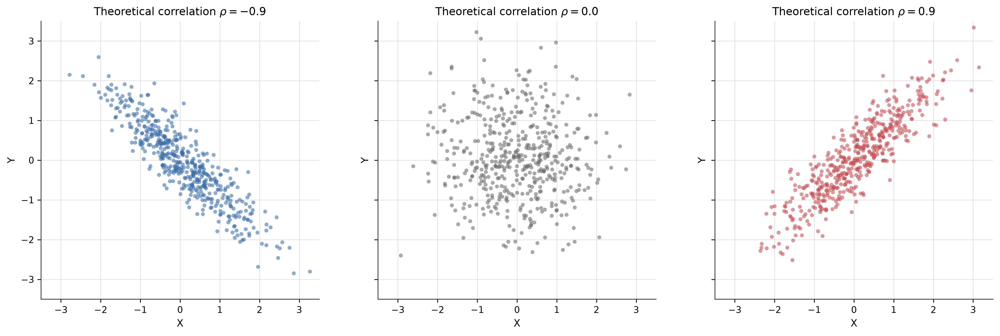

# 二维正态分布的相关结构及其统计推断

**基于 Python 的蒙特卡洛模拟研究｜概率论与数理统计课程大作业**

本项目通过理论分析与数值模拟，研究二维正态分布中相关系数对联合分布、边缘分布及条件预测的影响，并考察样本协方差、Pearson 相关系数估计和零相关假设检验在有限样本下的表现。

## 实验内容

| 实验              | 程序               | 主要内容                                                           |
| ----------------- | ------------------ | ------------------------------------------------------------------ |
| 1. 联合与边缘分布 | `experiment_01.py` | 比较 `ρ = −0.9、0、0.9` 时的散点图与边缘分布，每组 500 个样本      |
| 2. 条件分布与预测 | `experiment_02.py` | 在 `ρ = 0.9` 下分析 `0.5 < X < 1.0` 的条件分布、条件期望与预测误差 |
| 3. 相关系数估计   | `experiment_03.py` | 比较样本协方差与 Pearson 相关系数的估计误差，分析样本量的影响      |
| 4. 显著性检验     | `experiment_04.py` | 模拟 Pearson 零相关双侧检验，考察第一类错误率和统计功效            |

实验 3、4 使用 `n = 30、100、500、2000` 四种样本量，每种参数组合独立重复 1000 次；实验 4 的显著性水平为 `α = 0.05`。

## 部分实验结果



相关系数的符号决定联合点云的主要延伸方向，绝对值影响点云的集中程度；各组标准正态边缘分布保持一致。在 `ρ = 0.9` 时，理论最小均方预测误差为 `0.19`。蒙特卡洛实验还显示，估计误差随样本量增加而减小，弱相关关系需要更多样本才能获得较高的检验功效。

更多图表和统计结果见 [results](results/) 目录。

## 环境与运行

项目在 **Windows / Python 3.14.7** 环境下开发，使用 NumPy、SciPy、Matplotlib 和 pandas，具体版本见 [requirements.txt](requirements.txt)。

在项目根目录打开 PowerShell，创建虚拟环境并安装依赖：

```powershell
python -m venv .venv
.\.venv\Scripts\Activate.ps1
python -m pip install -r requirements.txt
```

按顺序运行四个实验：

```powershell
python src/experiment_01.py
python src/experiment_02.py
python src/experiment_03.py
python src/experiment_04.py
```

程序生成的数据和图片统一保存在 `results/` 中。

## 项目结构

```text
├── src/               # 四个 Python 实验程序
├── results/           # 8 张图片、5 份汇总表和 3 份基础样本数据
├── requirements.txt   # 固定版本的 Python 依赖
├── .vscode/           # VS Code 项目设置
└── README.md
```

全部实验采用固定随机种子，便于重新运行并核对结果。
